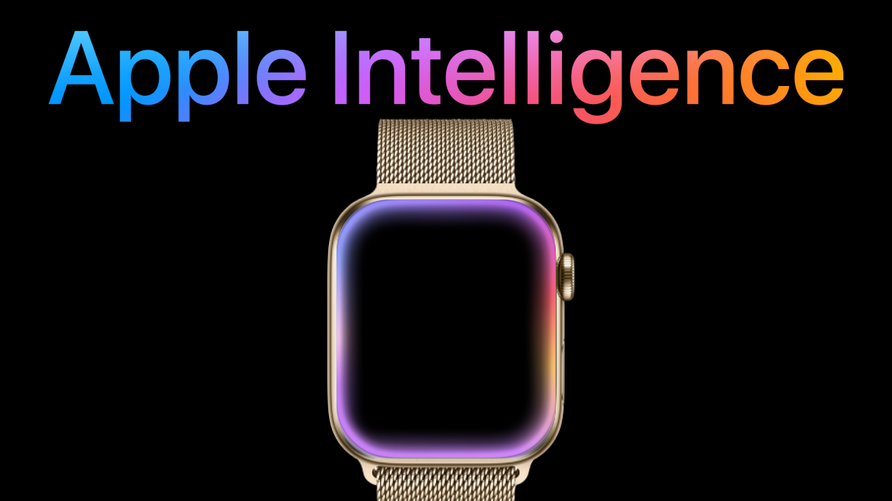
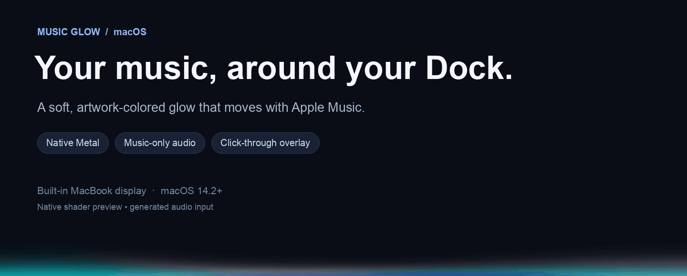
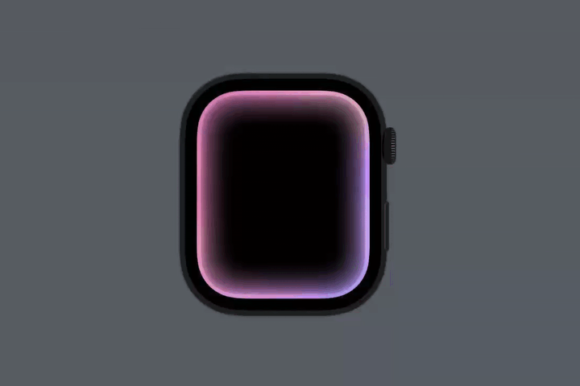
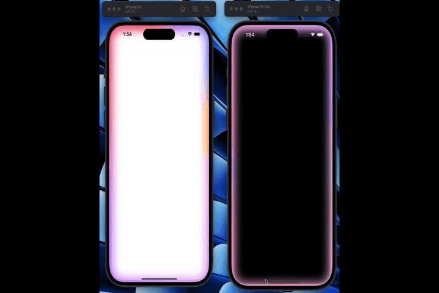

# Apple Intelligence Glow Effect

A customizable glow effect that mimics Apple's Intelligence UI design language. The iOS, iPadOS, and watchOS examples use SwiftUI. The native [macOS Music Glow app](macOS/README.md) uses Metal for an audio-reactive, artwork-colored glow along the bottom of the built-in display.



## Music Glow for macOS

**Your music, around your Dock.** A standalone menu bar app that brings the glow to your MacBook. Album artwork sets the colors; the music shapes the light.



*Six-second preview rendered with the app’s actual Metal shader and generated audio input. Live colors follow the current album artwork.*

[**Download Music Glow 1.0.0 · Apple Silicon**](macOS/releases/Music-Glow-1.0.0-macOS-arm64.zip) · [Setup & troubleshooting](macOS/README.md) · [Build from source](macOS/README.md#build-from-source) · [SHA-256](macOS/releases/Music-Glow-1.0.0-macOS-arm64.zip.sha256)

- **Artwork becomes atmosphere.** Four colors extracted from the current album blend gently as tracks change.
- **Light follows sound.** Bass, transients, and 64 frequency bands animate a soft glow across the bottom edge, with taller blooms at the corners.
- **Your desktop stays usable.** The transparent overlay lets clicks through; everything lives in the waveform menu bar icon.
- **Local and Music-only.** Analyzes Apple Music audio on your Mac. No saved recordings, uploads, audio drivers, or playback controls.

### Try it

1. Download and unzip the Apple Silicon package. Drag **Music Glow.app** into **Applications** and open it.
2. Open **Apple Music** and play a song. Allow Music automation and system audio recording when macOS asks.
3. Use the **waveform icon** in the menu bar to change sensitivity, try the 30-second visual preview, or quit.

Requires **macOS 14.2+**, Metal, and an **unmirrored built-in MacBook display**. The download is **arm64 / Apple Silicon**; Intel users can build from source, but Intel execution has not been tested. Use a bottom-positioned Dock for the intended appearance. This community build is **ad-hoc signed and not notarized**; see the [first-launch instructions](macOS/README.md#first-launch--permissions) if macOS blocks it.

## SwiftUI effects

The examples below are reusable SwiftUI views for iPhone, iPad, and Apple Watch.

### Features

- 🌟 SwiftUI examples — the standalone macOS app uses Metal
- 📱 Cross-platform support for Apple devices
- 🎨 Fully customizable colors and animations
- ⚡️ Optimized performance with configurable parameters
- 🔄 Smooth, fluid animations
- 🎯 Easy to integrate into existing projects
- 🔋 Low power mode variant for older devices and battery saving
- 🚀 Fixed timer leaks and reduced CPU usage from 100% to 20-60%

## Platform Support

- ✅ WatchOS (Complete)
- ✅ iOS (Complete)
- ✅ iPadOS (Complete)
- ✅ macOS 14.2+ — [Music Glow app with a native Metal renderer](macOS/README.md)

## Demos

### WatchOS
Two performance-optimized versions available:
- `WatchOS.swift`: Standard optimized version (Series 10, Ultra 1/2 compatible)
- `WatchOS_WithFreeze.swift`: Enhanced version with freeze capability and full WatchOS 11 compatibility (all watch sizes)

Both versions now feature:
- Fixed timer leaks that caused 100% CPU usage
- Optimized rendering with reduced CPU usage (30-50%)
- Better battery life



### iOS
Two stunning effects with performance-optimized variants:

1. **Type to Siri Effect** (`TypeToSiri.Swift`)
   - Optimized with proper timer cleanup
   - Minimal CPU usage (5-10%)
   - Suitable for all iOS devices

2. **Apple Intelligence Glow Effect**
   - `IOS.swift`: Standard version (optimized for iPhone 12+, 40-60% CPU)
   - `IOS_LowPowerMode.swift`: Ultra-performance version for older devices or battery saving (20-30% CPU)




### iPadOS
Optimized for iPad's larger display with adjusted parameters:
- Increased corner radius (65pt) for better visual proportion on larger screens
- Enhanced glow effect with adjusted blur radii and line widths
- Smooth animations perfectly tuned for iPad displays
**Performance Note:** All files have been optimized to fix critical timer leaks that caused 100% CPU usage. See [PERFORMANCE_GUIDE.md](PERFORMANCE_GUIDE.md) for complete optimization details and device recommendations.

## Integrate a SwiftUI effect

1. Copy the desired platform file (e.g., `WatchOS.swift`, `IOS.swift`, or `iPadOS.swift`) into your project
2. Import the file in your SwiftUI view
3. Implement the effect as shown in the examples below

## Customization Guide

### 1. Animation Timing
Adjust the animation speed and interval to match your needs:

```swift
Timer.scheduledTimer(withTimeInterval: 0.25, repeats: true) { _ in
    withAnimation(.easeInOut(duration: 0.5)) {
        gradientStops = GlowEffect.generateGradientStops()
    }
}
```

### 2. Color Customization
Modify the gradient colors to match your app's theme:

```swift
static func generateGradientStops() -> [Gradient.Stop] {
    [
        Gradient.Stop(color: Color(hex: "BC82F3"), location: Double.random(in: 0...1)),
        Gradient.Stop(color: Color(hex: "F5B9EA"), location: Double.random(in: 0...1)),
        Gradient.Stop(color: Color(hex: "8D9FFF"), location: Double.random(in: 0...1)),
        Gradient.Stop(color: Color(hex: "AA6EEE"), location: Double.random(in: 0...1)),
        Gradient.Stop(color: Color(hex: "FF6778"), location: Double.random(in: 0...1)),
        Gradient.Stop(color: Color(hex: "FFBA71"), location: Double.random(in: 0...1)),
        Gradient.Stop(color: Color(hex: "C686FF"), location: Double.random(in: 0...1))
    ].sorted { $0.location < $1.location }
}
```

### 3. Layer Customization
Fine-tune the effect's appearance by adjusting layer properties:

```swift
ZStack {
    // Base layer with no blur
    EffectNoBlur(gradientStops: gradientStops, width: 5)
        .onAppear {
            Timer.scheduledTimer(withTimeInterval: 0.25, repeats: true) { _ in
                withAnimation(.easeInOut(duration: 0.5)) {
                    gradientStops = GlowEffect.generateGradientStops()
                }
            }
        }
    
    // Blurred overlay layer
    Effect(gradientStops: gradientStops, width: 7, blur: 4)
        .onAppear {
            Timer.scheduledTimer(withTimeInterval: 0.3, repeats: true) { _ in
                withAnimation(.easeInOut(duration: 0.6)) {
                    gradientStops = GlowEffect.generateGradientStops()
                }
            }
        }
}
```

## Usage Examples

### Basic Implementation
```swift
struct ContentView: View {
    @State private var gradientStops: [Gradient.Stop] = []
    
    var body: some View {
        ZStack {
            // Your content here
            GlowEffect(gradientStops: gradientStops)
                .onAppear {
                    gradientStops = GlowEffect.generateGradientStops()
                }
        }
    }
}
```

### With Custom Parameters
```swift
struct CustomGlowView: View {
    @State private var gradientStops: [Gradient.Stop] = []
    
    var body: some View {
        ZStack {
            EffectNoBlur(gradientStops: gradientStops, width: 3)
            Effect(gradientStops: gradientStops, width: 5, blur: 3)
        }
        .onAppear {
            gradientStops = GlowEffect.generateGradientStops()
        }
    }
}
```

## Contributing

Contributions are welcome! Please feel free to submit a Pull Request.

## License

This project is open source and available under the MIT License.

---

⭐️ If this project helped you, please consider giving it a star!
