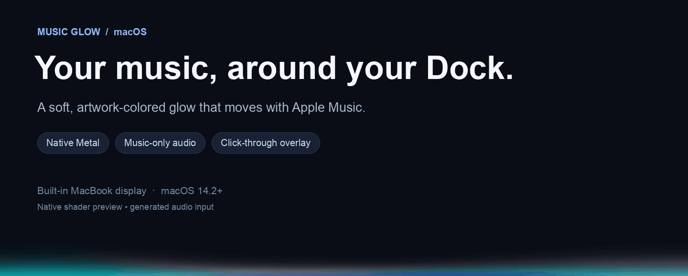

# Music Glow

### Your music, around your Dock.

A native macOS menu bar app that turns Apple Music into a soft, moving wash of light along the bottom of your built-in MacBook display. The album supplies the palette. Bass and transients lift the corners; the rest of the spectrum shapes the glow across the middle.



*Native Metal shader preview, generated audio input; no audio included. This is an illustration of the rendering, not a recording of a live song.*

[**Download 1.0.0 for Apple Silicon**](releases/Music-Glow-1.0.0-macOS-arm64.zip) · [Checksum](releases/Music-Glow-1.0.0-macOS-arm64.zip.sha256) · [Source](Sources)

## What it does

- Extracts a four-color palette from the current song’s artwork and blends colors over four seconds when tracks change. Blue and cyan are the loading fallback.
- Uses a Music-only Core Audio tap and 64 logarithmic FFT bands to animate a continuous, diffuse field. Bass and transients lift both corners; decaying peaks soften the release.
- Adds a small local bend as your pointer approaches. The panel passes clicks through and stays below the Dock and menu bar.
- Fades out when playback stops, suspends rendering on sleep, and reduces to 30 fps in Low Power Mode. Reduce Motion limits ambient drift and cursor influence.

No recording files, uploads, audio driver, playback control, output-device change, or automatic login item. Music metadata and audio analysis stay on your Mac.

### Live screenshot


*Unmodified screenshot of the running app’s bottom-edge panel. The warm palette comes from the current artwork; the transparent area appears against the capture’s background. Only the panel is captured, without other desktop windows.*

## Install

1. [Download the Apple Silicon ZIP](releases/Music-Glow-1.0.0-macOS-arm64.zip), unzip it, and drag **Music Glow.app** into **Applications**.
2. Open the app. It runs in the **menu bar**, with a waveform icon and no Dock icon.
3. Open **Apple Music**, play a song, and allow the permissions below.
4. Keep the built-in laptop display open and unmirrored. Put the Dock at the bottom for the intended appearance.

**Requirements:** macOS 14.2 or later and Metal. The prebuilt download is **arm64 (Apple Silicon)**. The source builds for the current Mac’s architecture; Intel execution is untested. External and mirrored displays are excluded. Audio capture can be unavailable for some protected content or playback paths.

### First launch & permissions

The download is **ad-hoc signed**, with no Developer ID certificate or Apple notarization. macOS may block downloaded copies. After checking the source of the download, use **System Settings → Privacy & Security → Open Anyway** if offered. If your Mac’s policy prevents this, [build from source](#build-from-source). You do not need to disable Gatekeeper.

Allow these requests:

| Permission | Purpose |
| --- | --- |
| Music automation | Read the current song and album artwork. |
| System audio recording | Analyze Music’s audio locally; no recordings are saved. |

If previously denied, enable Music Glow in **System Settings → Privacy & Security → Automation** and the **Screen & System Audio Recording / System Audio Recording Only** section (name varies by macOS). Relaunch if needed, then select **Retry Music & Audio** from the waveform menu.

## Controls

| Waveform menu item | What it does |
| --- | --- |
| Glow enabled | Toggle the overlay. |
| Sensitivity | Balanced, Punchy (default), or Extra Punchy; your choice is remembered. |
| Visual Preview (30 seconds) | Try the visual with generated input, without needing a song. |
| Retry Music & Audio | Reconnect metadata and audio capture after a permission or playback change. |
| Quit Music Glow | Stop the app and its audio tap. |

**Nothing showing?** Check that Glow is enabled, Apple Music is playing, permissions are granted, and the built-in display is active and unmirrored. Try Visual Preview to separate a display issue from missing audio. Protected or unavailable capture does not produce a fabricated spectrum; the menu reports the missing signal.

**Uninstall:** quit from the waveform menu and move Music Glow.app to Trash.

## Build from source

Install Xcode with its Metal toolchain, then:

```sh
git clone https://github.com/jacobamobin/AppleIntelligenceGlowEffect.git
cd AppleIntelligenceGlowEffect/macOS
./build-app.sh
open "dist/Music Glow.app"
```

The build targets the current Mac’s architecture. To create the ZIP with installation notes, licenses, and a SHA-256 checksum:

```sh
./package-release.sh
```

Files appear in `dist/`. `CODE_SIGN_IDENTITY` selects an installed signing identity; the default is ad-hoc signing. The script does not perform notarization.

## Performance and lifecycle

- One precompiled Metal pass and one triangle. Analytic Gaussian fields create translucent softness without blur passes or artwork textures in the render loop.
- Only the short bottom panel is shaded, at logical display resolution.
- 60 fps during playback; 30 fps in Low Power Mode. Drawing stops after playback fades out, on sleep, or without an eligible built-in screen. Reduce Motion stops ambient palette drift and reduces cursor influence.
- A private, unmuted Core Audio process tap targets Music alone. A bounded stereo ring keeps FFT work off the IO callback. Native tap lifetime runs on a serial background queue.
- 65 ms spectrum attack, 240 ms release and 440 ms peak decay. RMS, band meters, waveform and onset are smoothed separately to avoid flicker. Sustained bass uses a 350 ms gain reference with a four-second recovery. Brief buffer gaps retain features for up to 100 ms, then become silence.
- A persistent helper handles Apple Events. Notifications invalidate superseded responses; polling catches missed changes. Artwork is matched to track identity before publication.

On the development M5 Pro, the final offline 120-frame render averaged **0.139 ms GPU time per frame**. This measures GPU command execution, not compositor overhead or battery life. See [verification evidence](evidence/verification.md) for live measurements and boundaries.

## Verification and attribution

```sh
swift test
./build-app.sh
"dist/Music Glow.app/Contents/MacOS/MusicGlow" --check-scripts
"dist/Music Glow.app/Contents/MacOS/MusicGlow" --render-preview evidence/metal-dock-spectrum.png
```

Twenty-nine tests cover palettes, continuous track-color transitions, stereo FFT, transient detection, helper framing, lifecycle policies, Dock-height ceiling geometry and the actual GPU output. Render checks include taller wings, bass response at both ends, frequency-dependent shape, PCM-driven diffusion, silence, top-edge feathering at the actual render resolution, frame-rate-independent smoothing, bass normalization, bounded cursor influence and color drift independent of the audio silhouette.

Frequency mapping and interpolation/smoothing techniques incorporate MIT-licensed [Nowsee](https://github.com/Sergio-prog/Nowsee). The [pinned provenance and full license](ThirdParty/Nowsee/README.md) are included in the packaged app. Visual research also used [Aurora](https://github.com/tornikegomareli/Aurora) and [AppleIntelligenceForSwiftUI](https://github.com/alessiorubicini/AppleIntelligenceForSwiftUI). The moving color field and analytic edge diffusion are independent implementations adapted to this Music-only bottom panel; their full-screen SwiftUI code and binaries are not included.

Remaining manual checks include lid/cable changes, every full-screen Space and Dock arrangement, and audible AutoMix timing. Music exposes current-track artwork rather than both sides of an AutoMix transition, so the color blend starts when metadata changes. Denied or protected audio capture produces no fabricated spectrum; the menu reports a missing signal.

API reference: [Apple's Core Audio process-tap guide](https://developer.apple.com/documentation/coreaudio/capturing-system-audio-with-core-audio-taps).
